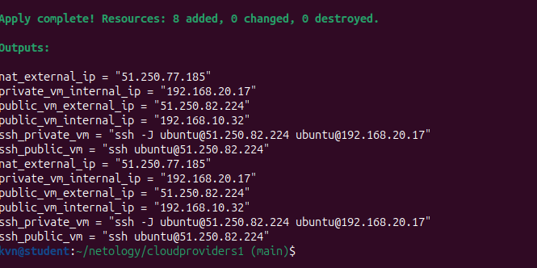
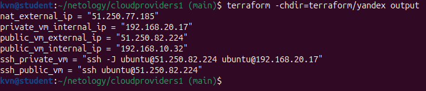
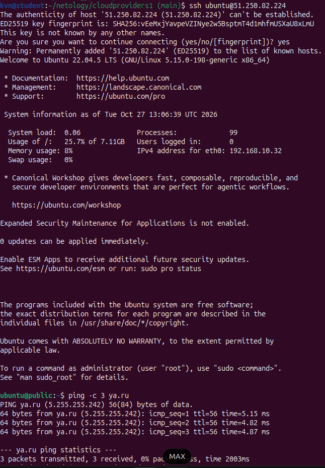
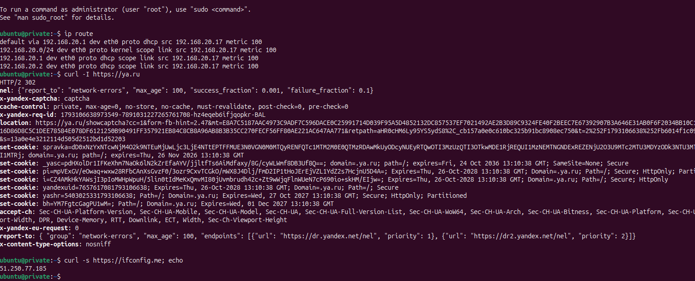
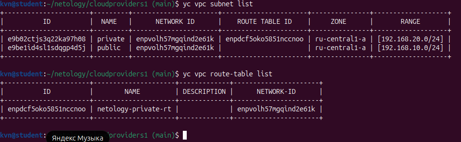

# Домашнее задание к занятию "Организация проекта при помощи облачных провайдеров. Организация сети"

Инфраструктура описана в Terraform, каталог `terraform/yandex`.

---

## Задание 1. Yandex Cloud

Создана пустая VPC в зоне `ru-central1-a` с двумя подсетями. В публичной — NAT-инстанс `192.168.10.254` и ВМ с публичным IP. В приватной — ВМ без публичного адреса, в интернет выходит через NAT-инстанс по статическому маршруту из отдельной таблицы маршрутизации.

### Файлы

| Файл | Содержимое |
|---|---|
| [providers.tf](terraform/yandex/providers.tf) | версия Terraform, провайдер, ключ сервисного аккаунта |
| [variables.tf](terraform/yandex/variables.tf) | переменные: идентификаторы облака, диапазоны подсетей, параметры ВМ |
| [network.tf](terraform/yandex/network.tf) | VPC, подсети `public`/`private`, таблица маршрутизации |
| [security.tf](terraform/yandex/security.tf) | группа безопасности: SSH, ICMP, трафик внутри VPC |
| [main.tf](terraform/yandex/main.tf) | NAT-инстанс, публичная и приватная ВМ |
| [outputs.tf](terraform/yandex/outputs.tf) | адреса машин и команды подключения |
| [terraform.tfvars.example](terraform/yandex/terraform.tfvars.example) | шаблон значений переменных |

### Параметры

| Параметр | Значение |
|---|---|
| Подсети | `public` — `192.168.10.0/24`, `private` — `192.168.20.0/24` |
| Зона | `ru-central1-a` |
| NAT-инстанс | `192.168.10.254`, образ `nat-instance-ubuntu` |
| Маршрут приватной подсети | `0.0.0.0/0` → `192.168.10.254` |
| Диски | тестовые ВМ — 8 ГБ (минимум для образа), NAT-инстанс — 4 ГБ |

### Скриншоты

#### Развёртывание стенда
`./deploy_yandex.sh` — окончание `terraform apply`: список созданных ресурсов и адреса машин.  



#### Адреса и команды подключения
`terraform -chdir=terraform/yandex output` — публичный адрес, внутренние адреса обеих машин и готовые строки `ssh`.  



#### Проверка интернета с публичной машины
`ssh ubuntu@51.250.82.224`, затем `ping -c 3 ya.ru` — выход в интернет напрямую.  



#### Проверка приватной машины
`ssh -J ubuntu@51.250.82.224 ubuntu@192.168.20.17`, затем `ip route` и `curl -s https://ifconfig.me` — внешний адрес совпадает с `nat_external_ip`, трафик из приватной подсети идёт через NAT-инстанс.  



#### Подсети и таблица маршрутизации
`yc vpc subnet list` и `yc vpc route-table list` — подсети `public` и `private`, таблица с маршрутом на NAT-инстанс.  



---

## Запуск

1. Скопировать `terraform/yandex/terraform.tfvars.example` в `terraform/yandex/terraform.tfvars` и заполнить: идентификаторы облака и каталога, путь к ключу сервисного аккаунта, публичный SSH-ключ. Без этого файла скрипт останавливается и печатает команду копирования.
2. Запустить `./deploy_yandex.sh` из корня проекта. Скрипт выполнит `terraform init` и `terraform apply`.
3. Проверить интернет с публичной и с приватной машины. Адреса и строки `ssh` печатает `terraform output`.
4. Удалить ресурсы: `./destroy_yandex.sh`, скрипт спросит подтверждение.

Нужны Terraform 1.12 или новее, ключ сервисного аккаунта Yandex Cloud и публичный SSH-ключ.

---

## Структура репозитория

```
.
├── README.md
├── READMEDZ.md                 # текст задания
├── deploy_yandex.sh            # развёртывание стенда
├── destroy_yandex.sh           # удаление ресурсов
├── screenshots/                # скриншоты к отчёту
└── terraform/
    └── yandex/                 # конфигурация задания 1
```

## Что не попадает в репозиторий

Файлы состояния Terraform, `terraform.tfvars` и ключи доступа перечислены в [.gitignore](.gitignore). Из значений переменных в репозитории только шаблон `terraform.tfvars.example`.
